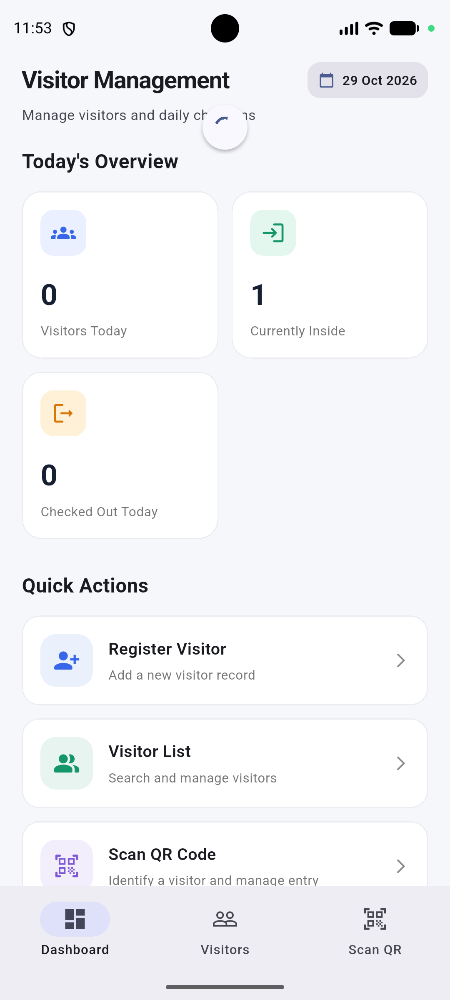
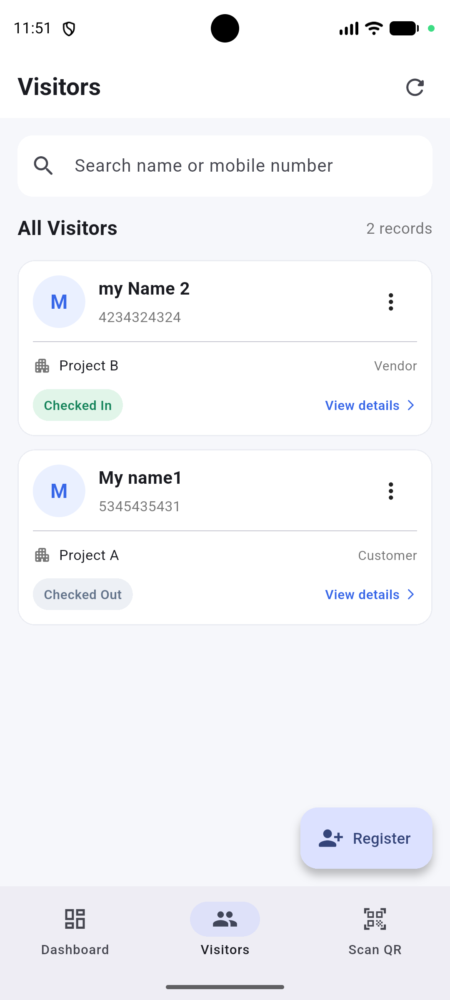
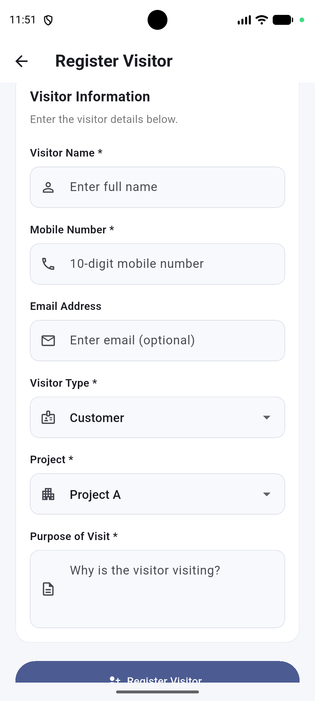
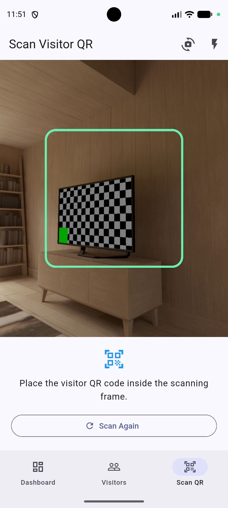

# Visitor Management Mobile Application

A cross-platform Flutter application designed for front-desk and security personnel to register visitors, manage visitor records across real estate project sites, generate and scan QR codes, and maintain real-time visitor check-in and check-out activities.

---

## 📱 Application Screenshots

| Dashboard | Visitor List |
| :---: | :---: |
|  |  |

| Visitor Registration | QR Code Scanner |
| :---: | :---: |
|  |  |

---

## ✨ Features

### 🏢 1. Real-Time Dashboard
- **Today's Overview Metrics**: Displays live stats for:
  - **Total Visitors Today**: Registered on the current device local date.
  - **Currently Checked In**: Active visitors currently on-site.
  - **Checked Out Today**: Visitors who completed their visit today.
- **Quick Action Shortcuts**: Direct navigation to Register Visitor, Visitor List, and Scan QR Code.

### 📝 2. Visitor Registration & Management
- **Registration Form**: Captures Name, 10-digit Mobile Number, Email (optional), Visitor Type (Customer, Vendor, Other), Project Site (Project A, Project B, Project C), and Purpose of Visit.
- **Validation**: Strict client-side validation for mandatory fields and 10-digit mobile numbers.
- **Edit & Delete**: Allows updating visitor information or deleting records with confirmation dialogs.

### 🔍 3. Visitor Listing & Advanced Filtering
- **Search**: Instant local search by visitor name or mobile number.
- **Filters**: Filter records by **Project** (Project A, B, C) or **Status** (Registered, Checked In, Checked Out).
- **Pull-to-Refresh**: Seamless gesture to fetch fresh data from the server.

### 📷 4. QR Code Generation & Camera Scanning
- **QR Code Generation**: Dynamically generates a high-resolution QR code encoding the unique server Visitor ID.
- **Camera Scanning**: Uses `mobile_scanner` to scan visitor QR passes, extract Visitor ID, retrieve live visitor profile from API, and enable instant check-in/check-out.
- **Safety Checks**: Handles camera permissions, invalid QR feedback, and prevents repeated/duplicate scanner callbacks.

### 🚪 5. Check-in & Check-out Workflow
- **Strict Status Lifecycle**: `Registered → Checked In → Checked Out`.
- **Duplicate Action Prevention**: Enforces business rules (cannot check out before check-in, cannot check in twice, completed visits cannot be re-checked in).
- **Activity Timeline**: Visual step-by-step visit activity history with timestamps.

---

## 🛠️ Technology Stack & Dependencies

- **Framework**: Flutter 3.47.7
- **Language**: Dart 3.13.5
- **State Management**: `provider` (ChangeNotifier architecture)
- **Service Locator / Dependency Injection**: `get_it`
- **Navigation / Routing**: `go_router` (StatefulShellRoute with persistent bottom navigation)
- **REST API Client**: `http`
- **QR Code Generation**: `qr_flutter`
- **QR Code Scanning**: `mobile_scanner`
- **Environment Management**: `flutter_dotenv`
- **Date Formatting**: `intl`

---

## 🏗️ State Management Architecture

The application uses the **MVVM (Model-View-ViewModel)** architectural pattern with **Provider** (`ChangeNotifier`) and **GetIt** service locator:

```
┌─────────────────┐       ┌──────────────────────┐       ┌──────────────────────┐       ┌─────────────────-┐
│   UI Screens    │ <---> │   VisitorViewModel   │ <---> │  VisitorRepository   │ <---> │ VisitorApiService│
│ (View / Widgets)│       │ (State & Filtering)  │       │  (Data Source)       │       │   (REST API)     │
└─────────────────┘       └──────────────────────┘       └──────────────────────┘       └─────────────────-┘
```

- **`VisitorViewModel`**: Central state holder managing visitor lists, search queries, active status/project filters, theme mode, and API state (`isLoading`, `errorMessage`).
- **`VisitorRepository`**: Bridges remote REST API calls.
- **`VisitorApiService`**: Handles REST requests (`GET`, `POST`, `PATCH`, `DELETE`) with timeout handling, authorization headers, and error parsing.

---

## 🌐 REST API Endpoints

The app communicates with a REST backend service (Supabase PostgREST):

| Method | Endpoint | Functionality |
| :--- | :--- | :--- |
| **GET** | `/rest/v1/visitors?select=*&order=created_at.desc` | Retrieve all visitor records |
| **GET** | `/rest/v1/visitors?select=*&id=eq.{id}` | Retrieve specific visitor by ID |
| **POST** | `/rest/v1/visitors` | Register a new visitor |
| **PATCH** | `/rest/v1/visitors?id=eq.{id}` | Update visitor details |
| **PATCH** | `/rest/v1/visitors?id=eq.{id}&status=eq.Registered` | Perform visitor Check-In |
| **PATCH** | `/rest/v1/visitors?id=eq.{id}&status=eq.Checked In` | Perform visitor Check-Out |
| **DELETE**| `/rest/v1/visitors?id=eq.{id}` | Delete visitor record |

---

## 🚀 Setup & Execution Instructions

### Prerequisites
- [Flutter SDK](https://docs.flutter.dev/get-started/install) (v3.47.6 or higher)
- Android Studio / VS Code with Flutter extension
- Android Device or Emulator (Android 8.0+ / API 26+)

### Installation Steps

1. **Clone the Repository**:
   ```bash
   git clone https://github.com/Mesavaraj/visitor_management.git
   cd visitor_management
   ```

2. **Install Dependencies**:
   ```bash
   flutter pub get
   ```

3. **Environment Configuration**:
   Ensure a `.env` file exists in the root project directory containing your API details:
   ```env
   SUPABASE_URL=https://your-supabase-url.supabase.co
   SUPABASE_PUBLISHABLE_KEY=your-supabase-publishable-key
   ```

4. **Run the Application**:
   ```bash
   flutter run
   ```

